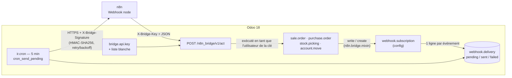

# n8n Bridge — Odoo 18 ⇄ n8n automation webhooks

> **EN —** Odoo 18 module that streams ERP events (order confirmed, delivery done, invoice posted) to n8n as HMAC-signed, retried webhooks, and lets n8n write back through one whitelisted, key-protected endpoint.
> **Status:** portfolio demo, exercised on Odoo 18.0 (official `odoo:18` image); not used in production. No automated tests yet.
> **Contact / source:** [github.com/seder2610](https://github.com/seder2610)

**FR —** Module Odoo 18 qui envoie les événements métier (commande confirmée, livraison faite, facture comptabilisée) vers n8n sous forme de webhooks signés (HMAC) avec reprise sur erreur, et permet à n8n de réécrire dans Odoo via un unique point d'entrée protégé par clé API et liste blanche.

---

## Problème → Solution → Pour qui

**Problème.** Connecter Odoo à n8n démarre toujours pareil : une URL de webhook collée dans une action automatisée, puis une deuxième, puis une troisième, jusqu'à ce que personne ne sache quel modèle déclenche quel workflow. Un n8n lent ou arrêté peut bloquer la confirmation d'une vente, et les échecs n'existent que dans un fichier de log.

**Solution.** Une seule surface de configuration dans Odoo :

- **Sortant** : `webhook.subscription` (modèle surveillé, déclencheur, URL, secret). Chaque événement devient une ligne `webhook.delivery`, signée HMAC-SHA256, envoyée par un cron toutes les 5 minutes — jamais dans la transaction de l'utilisateur. Les échecs restent visibles et relançables dans l'interface.
- **Entrant** : `POST /n8n_bridge/v1/act`, clé API liée à un utilisateur Odoo, et une liste blanche explicite de modèles / méthodes / champs modifiables.

**Pour qui.** Intégrateurs Odoo et ingénieurs en automatisation qui veulent un pont n8n ⇄ Odoo lisible et auditable plutôt qu'un connecteur par workflow.

---

## Résultat

Exemple réel, produit par une exécution sur une base Odoo 18 jetable avec les **données de démonstration** ci-dessous (client « Demo Customer », produit « Demo Product », URL `n8n.example.com`).

**Sortant** — confirmation d'un devis (`action_confirm`) avec une souscription *On state change only* sur `sale.order` :

```json
{
  "event": "state_change",
  "model": "sale.order",
  "record_id": 3,
  "values": {"name": "S00003", "state": "sale", "amount_total": 862.5,
             "partner_id": "Demo Customer", "date_order": "2026-10-25 10:30:58"},
  "timestamp": "2026-10-25T10:30:58"
}
```

Une ligne `webhook.delivery` est créée à l'état `pending` (0 tentative), signée dans `X-Bridge-Signature`. Aucune livraison n'est créée à la simple création du devis (déclencheur respecté).

**Entrant** — réponses réellement observées sur `POST /n8n_bridge/v1/act` (données de démonstration) :

| Appel | Statut | Corps |
|---|---|---|
| clé valide, champ `client_order_ref` | `200` | `{"model": "sale.order", "record_id": 4, "fields_written": ["client_order_ref"]}` |
| clé invalide | `401` | `{"error": "invalid_or_missing_api_key"}` |
| champ hors liste blanche (`amount_total`) | `403` | `{"error": "fields_not_whitelisted", "rejected": ["amount_total"], "allowed": ["client_order_ref"]}` |
| modèle hors liste blanche (`res.users`) | `403` | `{"error": "model_not_whitelisted", "model": "res.users"}` |

<!-- TODO capture: écran n8n Bridge ▸ Subscriptions (formulaire de souscription) -->
<!-- TODO capture: écran Deliveries avec une livraison failed + bouton "Retry now" -->
<!-- TODO capture: workflow n8n (Webhook node + vérification HMAC) -->

---

## Architecture



```
n8n_bridge/
├── models/
│   ├── webhook_subscription.py   config sortante, payload, signature HMAC, dispatch
│   ├── webhook_delivery.py       livraison en file, backoff, cron
│   ├── bridge_mixin.py           les hooks, écrits une fois, mixés dans 4 modèles
│   └── api_key.py                auth entrante + liste blanche action/champ
├── controllers/inbound.py        le point d'entrée unique
├── data/ir_cron.xml              cron d'envoi toutes les 5 minutes
├── views/                        écrans souscription, livraison, clé API + menu
├── security/                     droits d'accès, un groupe admin
└── migrations/18.0.1.0.0/        exemple de script pre-migrate
```

---

## Prérequis

| Élément | Valeur |
|---|---|
| Odoo | **18.0** (testé sur l'image officielle `odoo:18`) ; ne pas utiliser sur 17 (voir branche `main`) |
| Modules Odoo dépendants | `base`, `sale_management`, `purchase`, `stock`, `account` |
| Python | `requests` |
| Intégration externe | un n8n (ou tout récepteur HTTP) joignable depuis le serveur Odoo, avec un nœud *Webhook* |

---

## Installation

1. Placer le dossier `n8n_bridge/` dans un chemin de vos `addons_path` Odoo 18.
2. Redémarrer Odoo.
3. Installer le module : `odoo -d <DB> -i n8n_bridge --stop-after-init` (ou *Apps*).
4. Menu **n8n Bridge ▸ Subscriptions** : créer une souscription (modèle, déclencheur, URL du webhook n8n, secret).
5. Dans n8n, vérifier la signature `X-Bridge-Signature` avec le même secret (exemple ci-dessous).
6. Pour l'entrant : **n8n Bridge ▸ Inbound API Keys** → créer une clé, choisir l'utilisateur Odoo sous lequel elle agit.
7. Laisser tourner le cron *n8n Bridge: send pending deliveries* (5 min), ou le lancer à la main depuis *Paramètres ▸ Technique ▸ Actions planifiées*.

Vérifier la signature côté n8n :

```js
const crypto = require('crypto');
const expected = crypto.createHmac('sha256', SECRET)
                       .update(rawBody)
                       .digest('hex');
// comparer avec l'en-tête X-Bridge-Signature
```

Appeler Odoo depuis n8n :

```bash
curl -X POST https://<YOUR_ODOO_HOST>/n8n_bridge/v1/act \
  -H 'Content-Type: application/json' \
  -H 'X-Bridge-Key: <YOUR_API_KEY>' \
  -d '{"model":"sale.order","record_id":60,"values":{"client_order_ref":"REF-FROM-N8N"}}'
```

---

## Configuration

Aucun secret n'est stocké dans le dépôt : tout se règle dans l'interface Odoo ou dans `models/api_key.py`.

| Paramètre | Où | Valeur / placeholder | Défaut |
|---|---|---|---|
| URL du webhook n8n | Subscription ▸ `target_url` | `https://<YOUR_N8N_HOST>/webhook/<YOUR_WEBHOOK_ID>` | — (obligatoire) |
| Secret de signature | Subscription ▸ `secret` | `<YOUR_SHARED_SECRET>` (même valeur dans n8n) | — (obligatoire) |
| Modèle surveillé | Subscription ▸ `model_name` | `sale.order`, `purchase.order`, `stock.picking`, `account.move` | — |
| Déclencheur | Subscription ▸ `trigger` | création / toute modification / changement d'état | changement d'état |
| Champ d'état | Subscription ▸ `state_field` | nom du champ surveillé | `state` |
| Timeout HTTP | Subscription ▸ `timeout` | secondes | `8` |
| Clé API entrante | Inbound API Keys ▸ `key` | générée automatiquement (`secrets.token_urlsafe(32)`), bouton *Regenerate* | générée |
| Utilisateur de la clé | Inbound API Keys ▸ `user_id` | `<YOUR_ODOO_USER>` à droits restreints | utilisateur courant |
| Actions entrantes autorisées | `INBOUND_ALLOWED_ACTIONS` (`models/api_key.py`) | `action_confirm`, `button_confirm`, `button_validate` | liste ci-contre |
| Champs entrants autorisés | `INBOUND_ALLOWED_FIELDS` (`models/api_key.py`) | `client_order_ref`, `partner_ref`, `note` | liste ci-contre |
| Tentatives max / backoff | `MAX_ATTEMPTS`, `RETRY_DELAYS_MINUTES` (`models/webhook_delivery.py`) | 5 tentatives ; 5 min → 15 min → 1 h → 3 h | constantes |
| Taille de lot du cron | `cron_send_pending(batch_size)` | livraisons par passage | `50` |

---

## Statut et limites

**Statut.** Démonstration / portfolio. Ce n'est pas un module utilisé en production. Il a été installé et exercé sur Odoo 18.0 (image officielle `odoo:18`) ; les exemples de la section *Résultat* viennent d'une exécution réelle sur une base jetable.

**Limites connues.**

- **Aucun test automatisé** dans le dépôt : la vérification est manuelle (shell Odoo et appels HTTP).
- `WATCHED_MODELS` est une liste fermée de 4 modèles (`sale.order`, `purchase.order`, `stock.picking`, `account.move`).
- Le payload par défaut expose quelques champs communs ; surcharger `_build_payload` par modèle pour un vrai projet.
- Les livraisons partent séquentiellement depuis le cron, une requête HTTP chacune ; la taille de lot borne le travail par passage.
- Pas de protection anti-rejeu (nonce / fenêtre de temps) sur la signature sortante : à ajouter si le récepteur est exposé publiquement.
- La branche par défaut du dépôt (`main`) contient l'ancienne version Odoo 17 ; le module Odoo 18 est sur la branche `18.0`.

### Ce qui a changé par rapport au module 17.0

Le portage n'est pas un simple rafraîchissement de syntaxe : plusieurs comportements de la 17.0 ne fonctionnaient pas réellement.

**Blocages à l'installation / à l'exécution**

- **Le dispatch sortant levait une `AccessError` pour les utilisateurs ordinaires.** Les souscriptions étaient lues avec l'utilisateur courant alors que leur ACL est réservée au groupe admin du bridge. Le dispatch passe maintenant en `sudo()` : c'est de la plomberie système réagissant à l'action d'un utilisateur.
- **Personne ne détenait le groupe admin, pas même `admin`.** `group_n8n_bridge_manager` déclarait `implied_ids = [group_system]` (sens inverse). C'est désormais `base.group_system` qui implique le groupe bridge.
- **Le formulaire référençait `%(action_webhook_delivery)d`**, défini dans une vue chargée après lui. Le bouton est maintenant une action Python `action_open_deliveries()`.

**Configuration morte**

- **Le champ `trigger` ne faisait rien hors changement d'état** (pas de hook `create()`, `write()` ne réagissait qu'à `state`). Les trois déclencheurs se comportent maintenant comme leur libellé.
- **`state_field` était ignoré** (`state` en dur). Le champ de chaque souscription est désormais comparé, enregistrement par enregistrement.

**Protocole**

- **La route entrante était `type="json"`** (JSON-RPC) : un nœud HTTP Request de n8n ne pouvait pas l'appeler, et le statut HTTP retourné était ignoré. Elle est maintenant `type="http"` avec `request.get_json_data()` et `request.make_json_response(..., status=...)`.

**Performance**

- `_dispatch` faisait une `search` par enregistrement et un `create` par livraison. Les souscriptions sont maintenant résolues une fois par écriture via un `ormcache`, et toutes les livraisons sont créées en un seul `create` groupé.

**Maintenabilité**

- Les quatre `write()` identiques sont devenus un `AbstractModel` (`n8n.bridge.mixin`).
- `bridge.api.key` avait des ACL mais ni vue ni menu : ajout des écrans, d'un bouton *Regenerate key* et de `last_used_at`.
- Le README promettait un backoff mais le code relançait à chaque passage du cron : vrai backoff (`next_attempt_at`) et bouton *Retry now*.
- Comparaison des clés avec `hmac.compare_digest` au lieu d'une égalité SQL.
- `<field name="active">True</field>` (chaîne) → `eval="True"` dans le cron.

---

## Licence

LGPL-3 — voir [LICENSE](LICENSE).
